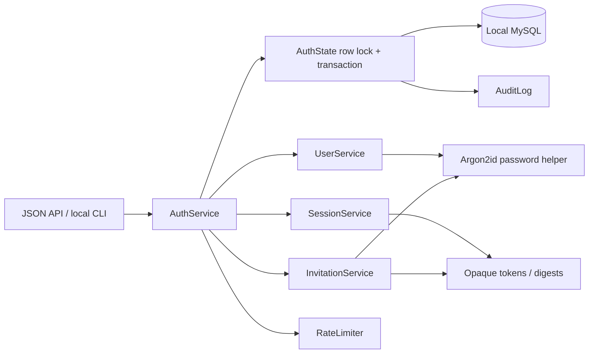

# Authentication and account operations — Section 3

The backend provides local account administration, invitation activation,
password recovery, revocable sessions, and reusable role/ownership checks.
The Section 9 frontend will connect the supplied design to these endpoints.
The [acceptance checklist](sections/03-authentication.md) defines verification;
[implementation choices](sections/03-implementation.md) explain the security
and concurrency decisions.

## Roles

| Operation | Admin | Operator | Reviewer |
| --- | --- | --- | --- |
| View runs/materials | Yes | Yes, all runs | Yes |
| Create production runs | Yes | Yes | No |
| Edit production runs | All eligible runs | Own eligible active runs | No |
| Review runs | Yes | No | No |
| Read audit logs / export | Yes | No | Yes |
| Manage materials/users | Yes | No | No |

Section 3 supplies the capability and ownership checks. Section 4 will enforce
production lifecycle eligibility inside each write transaction. A permission
dependency alone does not replace that transactional check.

## Local setup and recovery

Use the dedicated `prolog` conda environment and a configured local database.
For demonstrations, use a separate disposable database with synthetic users.

```powershell
conda activate prolog
cd D:\Program\Projects\ProLog\backend
python -m alembic upgrade head
python -m app.cli bootstrap-admin --account admin.local --name Administrator
python -m uvicorn app.main:app --reload
```

Bootstrap prompts twice for the password. It creates an Admin once; retries
and simultaneous attempts cannot create a second bootstrap account. Additional
Admins are invited by an existing Admin. An existing Admin can be recovered
from the trusted local console:

```powershell
python -m app.cli recover-admin --account admin.local
```

Recovery replaces the password, reactivates that existing Admin, revokes old
sessions/grants, and records an audit. It cannot promote an Operator or create
a new account. Keep operating-system access to this console restricted to
permitted administrators. Passwords are never command-line arguments.

## Session and password behavior

- Passwords contain 15–128 characters; spaces and Unicode are accepted.
  Passwords are not trimmed. Argon2id hashes use a random salt per password.
- Account identifiers are trimmed and lowercased ASCII letters/digits with
  dots, underscores, or hyphens, 3–100 characters, starting alphanumerically.
  Human display names can contain Unicode.
- Multiple server-side sessions may coexist. Each expires after 30 minutes
  without explicit foreground activity, or 12 hours after login, whichever
  occurs first. These defaults are configurable.
- GET requests and background polling do not extend idle expiry. The frontend
  calls POST `/auth/activity` only for real foreground activity. Expired
  sessions cannot be revived by activity; the user signs in again.
- Logout revokes its session. Password changes, completed recovery, account
  disable, and role changes revoke all of the affected user's sessions.
- Forced-password-change accounts may change their password or log out;
  other protected operations are denied until the change completes.
- Admins cannot disable/demote the final active Admin, including concurrent
  attempts. Disabling a pending account also revokes its activation links.

## Browser/API contract

All mutations require JSON, an allowed `Origin`, and `X-CSRF-Token`.
First GET `/auth/csrf` with cookies enabled, then send the returned token in
the header. Login rotates the session cookie and returns a new CSRF token.
Request another proof after cookies change. Tokens are bound to the HttpOnly
session/pre-auth cookie; CORS is not a substitute for server validation.

| Method / path | Access and result |
| --- | --- |
| GET `/auth/csrf` | Pre-auth or authenticated: returns `csrf_token`; does not refresh session activity. |
| POST `/auth/login` | `{account,password}` → safe user object and new `csrf_token`; sets HttpOnly session cookie. |
| GET `/auth/me` | Current permitted account; no idle renewal. |
| POST `/auth/activity` | Empty JSON object; renew idle activity within absolute expiry. |
| POST `/auth/logout` | Empty JSON object; revoke session and clear cookies. |
| POST `/auth/activate` | `{token,password}`; consume an activation grant and enable account; no automatic login. |
| POST `/auth/recover` | `{token,password}`; consume recovery grant and revoke old credentials. |
| POST `/auth/password` | `{current_password,new_password}`; change password and clear session cookies. |
| GET `/auth/users?offset=0&limit=50` | Admin; safe account records, maximum 100 per page. |
| POST `/auth/users` | Admin; `{account,name,role,position?}` → invited user and one-time activation URL. |
| POST `/auth/users/{id}/grants/activation` | Admin; empty JSON object; replace pending activation link. |
| POST `/auth/users/{id}/grants/recovery` | Admin; empty JSON object; issue recovery for an enabled, activated account. |
| PATCH `/auth/users/{id}` | Admin; `{role?,is_active?}`; validate last-Admin protection and revoke stale authority. |

The returned activation/recovery URL is `{PUBLIC_URL}/activate#token=...` or
`/recover#token=...`. The Admin copies it through an existing trusted channel;
the app sends no email. The fragment is intended for the Section 9 screen.
Until that screen exists, the API demonstration extracts the token and submits
it in the JSON body. Reissuing revokes earlier outstanding links. Defaults are
24 hours for activation and 30 minutes for recovery.

Typical errors: 400 invalid input/link, 401 invalid credentials/session,
403 insufficient authority/CSRF/forced password change, 409 conflicting account
state, 422 invalid JSON schema, 429 temporary throttling, and 503 unavailable
authentication storage. Errors omit submitted passwords, tokens and SQL.
Authentication responses use `Cache-Control: no-store` and `no-referrer`.

## Data and class relationships



```mermaid
sequenceDiagram
    actor Admin
    participant API
    participant DB as MySQL transaction
    actor User
    Admin->>API: Invite user (session + CSRF)
    API->>DB: Lock AuthState; recheck Admin
    API->>DB: Inactive User + hashed AccessGrant + audit
    API-->>Admin: Activation URL (shown once)
    Admin-->>User: Share URL through trusted channel
    User->>API: POST token + chosen password (CSRF)
    API->>DB: Lock; validate expiry/unconsumed; hash password
    API->>DB: Activate + consume grant + revoke old credentials + audit
    API-->>User: Activated; sign in
    User->>API: Login
    API->>DB: Verify password; store hashed session token + audit
    API-->>User: HttpOnly session cookie + CSRF proof
```

| Table / field | Type and purpose |
| --- | --- |
| `users.activated_at` | Nullable UTC `DATETIME(6)` / Python `datetime`; null while invited. Existing users are backfilled from `created_at` during upgrade. |
| `auth_state.id` | Integer primary key constrained to 1; seeded migration row locks serialize authentication operations across workers. |
| `auth_state.bootstrap_completed` | Boolean; blocks repeat first-Admin creation. Existing Admin rows mark setup complete during migration. |
| `login_sessions.id`, `user_id` | Integer PK and required User FK. |
| `login_sessions.token_digest` | Unique indexed 64-character SHA-256 hex digest; raw random token exists only in transport. |
| `login_sessions.created_at`, `last_activity_at`, `expires_at`, `revoked_at` | UTC `DATETIME(6)`; revocation nullable, expiry indexed. Positive lifetime and activity ordering CHECKs. |
| `access_grants.id`, `user_id`, `issued_by_id` | Integer PK, required recipient FK, nullable issuer FK. |
| `access_grants.token_digest`, `purpose` | Unique indexed 64-character digest; purpose constrained to activation/recovery. |
| `access_grants.created_at`, `expires_at`, `consumed_at`, `revoked_at` | UTC `DATETIME(6)`; consumption/revocation nullable, expiry indexed; positive lifetime CHECK. |
| `auth_throttles.key` | 64-character HMAC digest PK of the account/client-address scope; no plaintext address/account stored here. |
| `auth_throttles.attempts`, `expires_at` | Nonnegative integer counter and indexed UTC `DATETIME(6)` deadline. |

All new numeric fields are identifiers/counters/durations, so they are integers.
Physical quantities remain the existing `Decimal`/`DECIMAL(10,2)` fields.
Safe response `Identity` contains id/name/account/position/role, active status,
activation status and forced-password-change flag. It has no password hash or
stored credential. Audit actions name the event; their values never contain
passwords, raw tokens or activation links.

Authentication operations are serialized on one small coordination row. This
gives deterministic grant/final-Admin/bootstrap behavior across worker processes
and a clear atomic account/audit boundary, at the cost of auth throughput. The
factory deployment should benchmark this before increasing worker/client count.
Database failures roll back changes. Explicit login/grant failures preserve
only their attempt counter and failure audit; other rejected mutations roll back.

## Configuration and deployment boundary

See `backend/.env.example`. Production must use HTTPS `PUBLIC_URL` and CORS
origins, `SECURE_COOKIES=true`, and a random secret of at least 32 characters.
Secure cookies have `__Host-` names, path `/`, no Domain, HttpOnly and SameSite
Strict. HTTP development is for the local workstation only.

Attempt windows default to 900 seconds. Limits: five failed login attempts per
normalized account, 30 login attempts per client address, and 20 grant attempts
per client address. Successful login/recovery clears the account's failed-login
counter; address counters still bound overall load. Password-change attempts
also have a bounded per-user counter. Counters survive process restarts and
expire at their stored deadline. `429` supplies a conservative `Retry-After`.

The application uses the ASGI client address; it does not read arbitrary
forwarded headers. Configure trusted proxy handling explicitly in Section 15.
The database remains local and browser access remains restricted to LAN/VPN.

Migration `7a9b31c4d502` follows the approved Section 2 revision. Its upgrade
preserves existing account fields and role seeds. Downgrade drops authentication
sessions/grants/counters and the activation column; it does not delete existing
user or production rows. Run downgrade only for a deliberate rollback, not as
a normal operating step. The initial migration received docstrings only; its
schema and seed operations are unchanged.

The metadata now includes the approved production server defaults. Boolean
defaults use numeric SQL `0`/`1`, matching MySQL reflection; comparison remains
enabled for all defaults. Migration tests deliberately change an expected
default and assert that drift is reported, on both SQLite and MySQL.

## Executable demonstrations and verification

From `backend/`, in the existing conda environment:

```powershell
python -m pytest tests/test_auth_api.py -q
python -m pytest tests/test_auth_services.py tests/test_auth_config_cli.py -q
python -m pytest tests/test_auth_migrations.py -q
```

These demonstrate the actual API/CLI flow with synthetic accounts, including
CSRF, activation, repeated-link rejection, role denials, disable/revocation,
expiry and recovery. The API tests use FastAPI TestClient and a disposable
database; they are not a browser implementation. Database concurrency tests
run in CI on migrated MySQL 8.4, while unit tests run on Windows and Linux.
Production lifecycle screens and browser walkthroughs remain later sections.

The [full Section 3 review](reviews/section-03-review.md) records the tested
commit, CI results, resolved findings and remaining limits. No owner
verification or authorization for Section 4 is implied by passing these tests.
