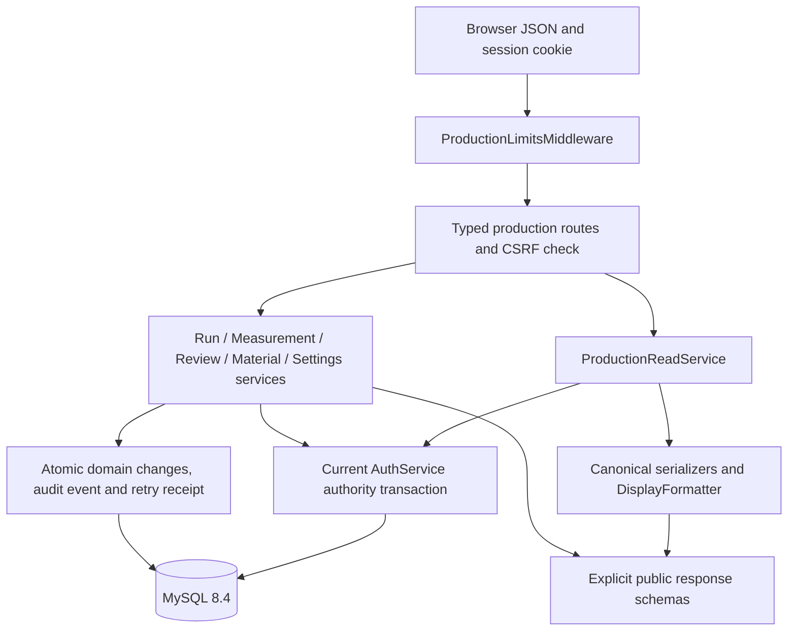

# Production backend API

Section 5 exposes the approved production services over HTTP. Start the backend
using [README](../README.md); `/docs` and `/openapi.json` describe the exact
request/response schemas. Authentication operations remain under `/auth` and are
documented in [authentication](authentication.md). The frontend is still a scaffold.

## Routes and permissions

All paths below start with `/production`. Every route requires a live session
with the current role and no outstanding mandatory password change.

| Method / path | Behavior | Permitted role |
| --- | --- | --- |
| GET `/runs` | Page run metadata, newest start time then highest ID first. | Admin, Operator, Reviewer |
| POST `/runs` | Start a run at server time, capturing rules and recording accuracy. | Admin, Operator |
| GET `/runs/{id}` | Run metadata, measurement count and missing count; no embedded measurement array. | All three |
| GET `/runs/{id}/measurements` | Page samples by measurement time then ID ascending. | All three |
| POST `/runs/{id}/measurements` | Record a partial/complete scheduled or extra sample. | Admin; owning Operator on eligible runs |
| PUT `/runs/{id}/measurements/{sample_id}` | Correct one sample with a reason and both revisions. | Admin; owning Operator on eligible runs |
| GET `/runs/{id}/schedule` | Bounded real/virtual scheduled positions and completeness. | All three |
| POST `/runs/{id}/close` | Close eligible production for review. | Admin; owning Operator, subject to current controls |
| POST `/runs/{id}/review` | Final reasoned decision, including audited self-review. | Admin |
| GET `/materials`, `/materials/{id}` | Exact standards, including inactive history. | All three |
| POST `/materials` | Create a named standard. | Admin |
| PUT `/materials/{id}` | Replace rules and activation state with a reason. | Admin |
| GET, PUT `/settings/accuracy` | Read/update recording defaults and Operator abnormal-run authority. | Admin |
| GET `/settings/display` | Current factory-wide presentation policy. | All three |
| PUT `/settings/display` | Change display precision/rounding without rewriting history. | Admin |
| GET `/audit-logs` | Original audit event metadata and before/after payload text. | Admin, Reviewer |
| GET `/overview` | All-time current status counts, Shanghai today's starts, five recent runs. | All three |

The role named Reviewer remains read/export-only. It cannot approve runs.
Operators cannot export or view audit logs. Export delivery belongs to Section 7.
Operator work on their own Abnormal runs follows the current Admin switch.
Missing-data closure needs an Admin reason. Pending-review/Reviewed records
cannot be edited. See [lifecycle](run-lifecycle.md) for all transition rules.

## Request and response contract

- Use the configured HttpOnly session cookie. Obtain a proof from `/auth/csrf`
  and send `X-CSRF-Token`, a trusted `Origin`, and `Content-Type: application/json`
  on every POST/PUT. A pre-login CSRF cookie does not authorize production work.
- Every mutation includes a UUID string `request_id`. Retries by the same actor
  with the same operation/payload return the stored canonical receipt; a changed
  payload under the same UUID returns 409. Use a new UUID for a new intended write.
  Creation and its successful retry both return 201; updates return 200.
- Updates require the most recent `expected_revision`. Measurement writes use
  `expected_run_revision`; corrections also require the sample's `expected_revision`.
  On 409, refresh and let the user reconcile the change. Do not silently overwrite.
  A historical retry receipt may have an older revision: refetch before new work.
- Bodies reject unknown fields and type coercion. IDs, revisions, counts, interval
  seconds and decimal-place settings are integers. IDs/revisions must be positive
  and at most 2,147,483,647; places range from 0 to 6. JSON booleans are required
  for switches. Recording/display policy updates require every precision field.
- Measured quantities and calculated values travel as decimal strings, never
  JSON floating-point numbers. Input uses ordinary decimal notation, such as
  `"100.00"`, `"0.007"`, or `"0"`; exponent notation, NaN and excess places fail.
  Null/omitted readings mean missing data; zero is recorded data.
- Measurement PUT is a complete replacement: supply every reading to retain,
  the measurement time, and its `slot_index` if scheduled. Omitted readings become
  missing and an omitted/null slot means an extra manual sample. Supply the
  correction reason. Materials PUT replaces rules and activation state; it cannot
  rename a material. Rule switches default to true and deviation tolerance to
  `"2"` if omitted, so clients should submit the complete fetched rule set.
- Output times are UTC ISO strings ending in `Z`. Input measurement times with
  offsets are normalized; naive production times mean Asia/Shanghai. The server
  retains actual recording time separately and rejects future/pre-run times.
- JSON bodies are limited to 64 KiB, including bodies streamed without an honest
  Content-Length. String and page bounds apply in addition to this byte limit.

Run/sample canonical values use captured accuracy. Material canonical values
remove database padding zeros without rounding meaningful digits, including
inactive standards created at older accuracy. Separate `display` fields use
the current display policy. Measurement pages include `accuracy`,
`calculation_version`, `run_revision` and `display_settings`. Render rounded
copies; populate editing controls from canonical fields. Never infer an alarm
from rounded display values. Mutation receipts retain canonical history; fetch
a current read after mutation to obtain display copies.

Collection GETs accept `offset` (default 0) and `limit` (default 50, maximum 200),
and return `items`, `offset`, `limit`, `total`, `has_more`. Material order is ID
ascending; audit order is ID descending. Pages beyond the end are empty and
retain the total. Schedule is its existing domain contract: `id`, `revision`,
`expected_count`, `missing_count`, `offset`, `slots` with at most `limit` entries.
All pages are current reads; offset pagination is not a cross-request snapshot.
Concurrent inserts/corrections can move rows between pages. Section 6 will define
search selections, date filters, indexes and performance targets.

Overview returns `as_of`, `factory_timezone`, `factory_date`, `total_runs`,
`today_started_runs`, `status_counts` and `recent_runs`. Today's starts use
Shanghai midnight inclusive through the next midnight exclusive. Status counts
describe all stored runs' current states, not just today's runs. Completion and
quality-rate definitions remain a Section 10 decision. Legacy runs retain their
read-only marker; unknown scheduled completeness is null, and schedule requests
for legacy runs return 409 instead of inventing historical samples.

| HTTP status | Client meaning |
| --- | --- |
| 400 | Invalid transport/domain value; `detail` is a safe code. |
| 401 | Missing, expired or revoked session; sign in again. |
| 403 | Role, ownership, mandatory password change or browser-proof rejection. |
| 404 | The requested permitted parent/record is absent or does not match. |
| 409 | Conflicting retry/revision, duplicate identity or ineligible lifecycle state. |
| 413 / 415 | Body too large / unsupported content type. |
| 422 | Schema or production-value rejection; fix the submitted fields. |
| 503 | Database operation failed; no successful partial mutation is committed. |

Expected errors return `{"detail":"code"}`. Schema errors use a `detail` array
containing `loc` and `type`, omitting submitted input. Production success/error
responses are marked `Cache-Control: no-store`, `Pragma: no-cache`, and
`Referrer-Policy: no-referrer`. Read polling never renews session idle time; the
future frontend must use the existing explicit activity mechanism for user input.

## Class relationships and data flow

`ProductionReadService` extends `ProductionStore` and reuses its serializers,
accuracy lookup and display policy. It queries limited rows and aggregate counts;
it does not load a run's entire sample relationship. Writes use only the Section 4
services; router code performs no raw ORM mutation. Current authority and settings
are checked within the existing serialized auth transaction, so revocation cannot
race a permitted write. This design's global lock is an acknowledged throughput
constraint, to be measured before high-volume search or machine intake.

This section adds no tables or migrations. The [data model](data-model.md) and
[lifecycle guide](run-lifecycle.md) remain the persistence/type references.

## Repeatable demonstration

1. Use a disposable migrated database and the existing local bootstrap procedure.
   Sign in through `/auth/login` with the cookie/CSRF procedure in the auth guide.
2. Create an Admin material, then POST a run with its material ID, batch,
   whole-second sampling interval and a new UUID. Retain its returned ID/revision.
3. POST a sample using the returned run start time, slot 0, four resistance
   readings, thickness and meter count as strings. Speed may be null. Read the
   separate measurement page and schedule; compare canonical and display fields.
4. Correct the sample with both returned revisions and a reason. For an abnormal
   test, enter a resistance point beyond the material's target tolerance; the run
   stays Abnormal after a later correction. Confirm stale revisions return 409.
5. Close with the latest run revision. An overdue/missing sample requires an Admin
   exception reason. Record the applicable Admin review decision and reason.
   Retry the same request: the receipt is unchanged and no extra audit is added.
6. Change only display precision, then refetch the old sample. Its original
   reading, captured accuracy and alarm remain intact. Inspect original audit
   payloads as Admin/Reviewer; verify Operator audit access is denied.

Automated counterparts and limits are in the [acceptance plan](sections/05-backend-api.md)
and [full review](reviews/section-05-review.md). No interactive frontend or live
factory database walkthrough is claimed by the HTTP tests.
