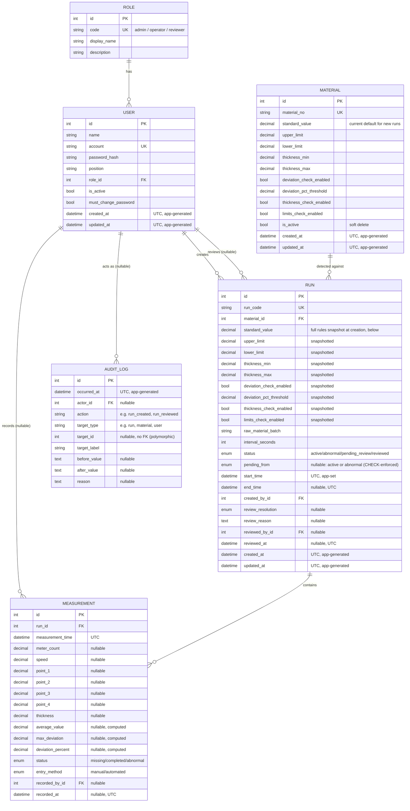
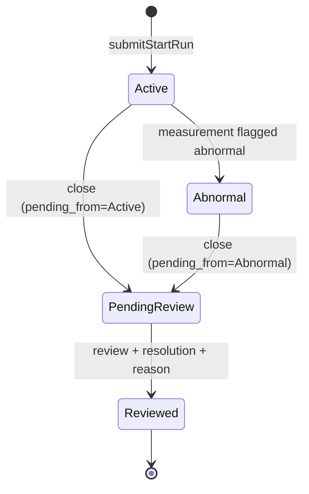

# Data Model (Section 2)

## Entity-relationship diagram

## Run state machine

There is no "closed without review" path — every run reaches its
terminal state (`Reviewed`) through review. `review_resolution` is
`approved` when `pending_from=active`, or the reviewer's choice of
`confirmed_abnormal` / `false_alarm` when `pending_from=abnormal`.

## Design decisions and why

- **Role is a normalized table**, not an enum column on User. Only 3 rows
  exist today (seeded by the initial migration), but a future role (or
  per-role metadata) becomes a data change instead of a schema migration.
- **No separate ReviewRecord table.** Review outcome lives directly on
  Run (`review_resolution`, `review_reason`, `reviewed_by_id`,
  `reviewed_at`) — one decision per run, matching the actual workflow.
  There's no reopen/re-review history; `Reviewed` is terminal.
- **Run snapshots the full abnormality-rules set from Material at
  creation time** — not just `standard_value`, but every field of
  `AbnormalityRulesMixin` (upper/lower limits, thickness bounds, which
  checks are enabled, the deviation threshold). Material and Run both
  use the same mixin so the fields can't drift out of sync with each
  other. This is what makes a separate material-standard-version-history
  table unnecessary: an existing run's measurements — including ones
  added after a material's rules are edited, while the run is still
  active — are always judged against *its own* snapshotted rules, never
  a live lookup. Changes to a material's rules are still visible via
  AuditLog (before/after free text), matching how material standard
  changes were already shown in the original design.
- **All measured physical quantities and calculated numeric results use
  `DECIMAL(10, 2)`**, mapped to Python `Decimal` (never `float`).
  Identifiers, counts, and whole-second intervals (`id`, `interval_seconds`)
  are plain integers — the DECIMAL policy is about values that could
  carry a fractional/measured component, not every numeric column
  indiscriminately. See `CONTRIBUTING.md`.
- **`Measurement.entry_method`** (manual/automated, default manual) is
  the one column added now in anticipation of the Section 8 ingestion
  portal — deliberately minimal (a single column) rather than a fuller
  speculative field set, since Section 8 itself isn't scoped yet.
- **`AuditLog.action`** is a short indexed string (e.g. `run_created`,
  `run_reviewed`, `material_deactivated`) naming what kind of event
  happened, separate from `target_type`/`target_label` (what it happened
  to) and `before_value`/`after_value`/`reason` (the free-text detail).
  Not a fixed enum, since the set of actions grows as later sections
  each add their own.
- **`AuditLog.target_id` has no FK constraint** — it's polymorphic
  (points at a run, material, or user row depending on `target_type`),
  and before/after are free text rather than structured per-field diffs,
  matching the original design's simple audit trail.

## Constraints

Beyond FKs/uniqueness, CHECK constraints enforce structural invariants
that are true regardless of workflow (`app.models.mixins.
abnormality_rule_constraints`, shared by `materials` and `runs` since
both use `AbnormalityRulesMixin` — declared once, applied to both
tables; MySQL requires constraint names unique per-database, so each
name is table-prefixed):

- `lower_limit <= upper_limit`
- `thickness_min <= thickness_max`
- `deviation_pct_threshold >= 0`
- `runs.interval_seconds > 0`
- `runs.pending_from IS NULL OR pending_from IN ('active', 'abnormal')`
  — `pending_from` has to share `status`'s full `RunStatus` column type,
  so without this the DB would otherwise silently accept e.g.
  `pending_from='reviewed'`, which is a legitimate enum member but
  nonsensical here.
- `runs.end_time IS NULL OR end_time >= start_time`

**Deliberately not** database constraints: status-conditional
invariants like "`status=reviewed` implies `reviewed_by`/
`review_resolution`/`reviewed_at` are set" or "`status=active` implies
they aren't." These are workflow transitions, not static row shape, and
belong to Section 4's `RunService`/`ReviewService` — the sole writers of
those columns — tested comprehensively there rather than duplicated as
CHECK expressions that would need a migration every time the state
machine evolves.

## Time policy

Every timestamp column is a naive `DATETIME` (no timezone) that
represents **UTC by convention**:

- Timestamps are generated in **application code**
  (`app.core.time.utcnow()`), not by the database server
  (`server_default=func.now()`) — correctness doesn't depend on the
  MySQL server's session/global `time_zone` being configured correctly.
  `TimestampMixin` and `AuditLog.occurred_at` both use it.
- MySQL's `TIMESTAMP` type was deliberately not used — it has a 2038
  range limit, a real constraint for on-premise industrial software with
  a long deployment lifetime. Plain `DATETIME` storing UTC by convention
  has no such limit.
- Domain timestamps the service layer sets explicitly (`start_time`,
  `end_time`, `reviewed_at`, `measurement_time`, `recorded_at`) follow
  the same UTC-naive convention — Section 4 must normalize any
  user-entered production time (assumed to be in the factory's
  configured timezone) to UTC before storing it.
- Conversion to the factory's display timezone happens only at the
  presentation layer (frontend rendering, export formatting) — never in
  the database or domain model.

## Indexing

The initial migration only indexes natural unique identifiers
(`roles.code`, `users.account`, `materials.material_no`, `runs.run_code`)
plus `audit_logs.action`. Section 6 (Search) will need additional indexes
based on its actual query patterns — recorded here as an explicit
dependency, not finalized yet:

- `runs(start_time)`, `runs(status, start_time)`,
  `runs(material_id, start_time)`, `runs(raw_material_batch)`
- `measurements(run_id, measurement_time)`
- `audit_logs(occurred_at)`, `audit_logs(target_type, target_id)`

## Migration

`backend/alembic/versions/0c3dff882627_initial_schema.py` — hand-written
(no local MySQL was available for `alembic revision --autogenerate`),
verified locally against SQLite (upgrade/downgrade round-trip, UTF-8
role names checked byte-exact via assertions) and against real MySQL 8.4
via CI's Alembic smoke test. Enum values are inlined as literals in the
migration rather than imported from `app.models.enums`, since migrations
are a frozen historical record and should not silently drift if an enum
changes in a later migration.

The migration's seeded role data (admin/operator/reviewer) is verified
against the real, migrated database by `backend/scripts/
verify_seed_data.py`, run in CI between `alembic upgrade head` and
`alembic downgrade base` — not just by a unit test that only proves the
`Role` model *can* hold three distinct rows without ever touching what
the migration itself inserted.
