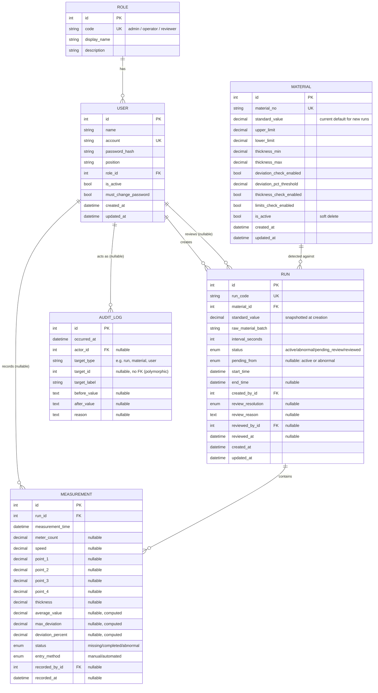
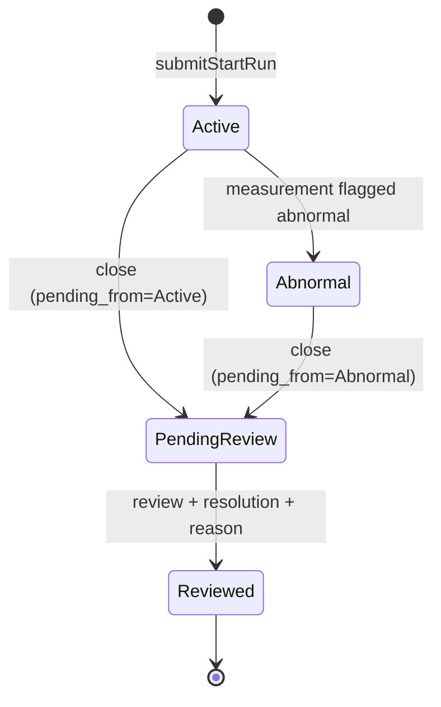

# Data Model (Section 2)

## Entity-relationship diagram

## Run state machine

There is no "closed without review" path — every run reaches its
terminal state (`Reviewed`) through review. `review_resolution` is
`approved` when `pending_from=active`, or the reviewer's choice of
`confirmed_abnormal` / `false_alarm` when `pending_from=abnormal`.

## Design decisions and why

- **Role is a normalized table**, not an enum column on User. Only 3 rows
  exist today (seeded by the initial migration), but a future role (or
  per-role metadata) becomes a data change instead of a schema migration.
- **No separate ReviewRecord table.** Review outcome lives directly on
  Run (`review_resolution`, `review_reason`, `reviewed_by_id`,
  `reviewed_at`) — one decision per run, matching the actual workflow.
  There's no reopen/re-review history; `Reviewed` is terminal.
- **Run snapshots `standard_value` from Material at creation time.** This
  is what makes a separate material-standard-version-history table
  unnecessary: an existing run's measurements are always judged against
  *its own* snapshotted value, never a live lookup, so a later change to
  a material's current standard can never retroactively change how a
  past run's data reads. Changes to a material's standard are still
  visible via AuditLog (before/after free text), matching how material
  standard changes were already shown in the original design.
- **All numeric columns are `DECIMAL(10, 2)`**, mapped to Python
  `Decimal` (never `float`), applied uniformly across every numeric
  field rather than case-by-case — see `CONTRIBUTING.md`.
- **`Measurement.entry_method`** (manual/automated, default manual) is
  the one column added now in anticipation of the Section 8 ingestion
  portal — deliberately minimal (a single column) rather than a fuller
  speculative field set, since Section 8 itself isn't scoped yet.
- **`AuditLog.target_id` has no FK constraint** — it's polymorphic
  (points at a run, material, or user row depending on `target_type`),
  and before/after are free text rather than structured per-field diffs,
  matching the original design's simple audit trail.

## Migration

`backend/alembic/versions/0c3dff882627_initial_schema.py` — hand-written
(no local MySQL was available for `alembic revision --autogenerate`),
verified locally against SQLite (upgrade/downgrade round-trip, UTF-8
role names) and against real MySQL 8.4 via CI's Alembic smoke test.
Enum values are inlined as literals in the migration rather than
imported from `app.models.enums`, since migrations are a frozen
historical record and should not silently drift if an enum changes in a
later migration.
