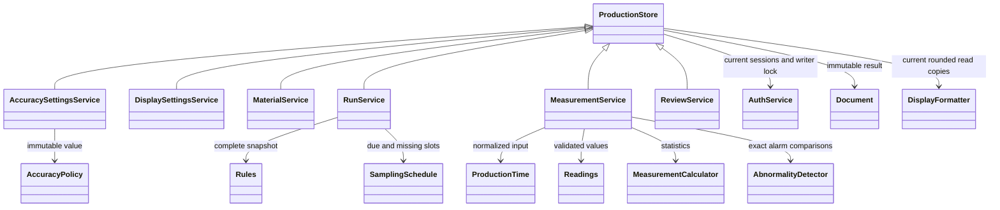

# Production domain services — Section 4

Implemented on `codex/section-04-run-lifecycle`, based on Section 3 `f7bee48`.
Owner decisions D19–D29 define the behavior. Production HTTP endpoints are
Section 5, the new Admin settings page is Section 11D, and operational screens
are Sections 10–13. This document describes backend services, not delivered UI.

## Workflow

1. Admin maintains material target/limits and the factory accuracy policy.
2. Admin or Operator starts a run. The service captures all nine material rules
   and the current immutable accuracy version, generates a unique run code,
   and records creator and server UTC time.
3. Expected sample zero is due at run start, then one sample every whole-second
   interval. A sample measured in `[due time, next due time)` can fill that slot.
   Submission may occur later, while the run remains editable. Extra manual
   samples have no slot index and cannot substitute for missed scheduled slots.
4. Save partial rows freely within authority. A completed row needs all four
   resistance points and meter count, plus thickness if its check is enabled.
   Speed is optional. Null means absent; zero means a real recorded value.
5. Available readings trigger enabled alarms immediately, even in a partial
   row. Missing required data keeps its row status Missing; alarm codes and
   the Abnormal run state remain independently visible. Four-point statistics
   are absent until all four resistance readings are present.
6. Close for review. Count every due unfilled/incomplete slot plus incomplete
   extra manual rows. An Admin must supply a reason to close with any gap.
   Store end time, missing count and exception reason permanently.
7. Admin records a reason and an eligible review resolution. Active-origin
   runs use Approved; Abnormal-origin runs use Confirmed Abnormal or False Alarm.
   Reviewed is terminal. A review with gaps retains the gap and its explanation;
   Approved is the Admin's decision, not a claim that missing samples passed.

Abnormality is sticky: a corrected or later normal sample never silently clears
the need for review. Operators can initially edit/close their own Active and
Abnormal runs. Admin can disable Operator Abnormal-work authority immediately.
Missing-data exceptions remain Admin-only. Reviewer has read/export authority
and no production writes or operational review authority.

Every review needs a reason, including self-review. The audit explicitly marks
self-review if the Admin created the run or previously recorded/corrected one
of its measurements, even if another user later corrected that same row.

## Numeric and time policy

| Group | Initial decimal places | Unit |
| --- | --- | --- |
| Resistance input and material resistance rules | 2 | Ω |
| Thickness input and material thickness rules | 3 | mm |
| Speed | 2 | m/min |
| Meter count (measured length) | 2 | m |
| Calculated results and deviation tolerance | 2 | Ω or % according to field |

Admin selects 0–6 places per group and half-up (initial) or half-even rounding.
Store each policy version permanently; a run never switches to a newer version.
New policy publication rejects incompatibility with active material standards.
Inactive standards are checked when edited/reactivated, so they cannot prevent
all future precision changes indefinitely. Standards are never silently rounded.

Input uses canonical decimal strings, with no float conversion, exponent
syntax, whitespace or excess fractional digits. Missing input is null. Physical
quantities are nonnegative and at most `99999999.999999`; the material target
must be positive. IDs/counts/intervals/revisions/scale settings remain integers.
Results use a private 60-digit Decimal context, then the captured output scale.
Stored numeric capacity is `DECIMAL(24,6)`; its larger integer portion supports
percentages against very small positive targets. Unsupported overflow is rejected.

Target alarm: `max(abs(point - target)) × 100 > target × tolerance`.
The cross-product comparison avoids quotient rounding at the decision boundary.
Equality passes. Enabled absolute resistance and thickness limits also have
inclusive boundaries and remain independent. Uniformity is maximum absolute
distance from the four-point mean divided by that mean, times 100; it is
informational. For four zeros the mean is zero and uniformity percentage is
null (undefined), while target deviation is 100%.

Input without an offset means Asia/Shanghai. Explicit offsets/Z normalize to
the same UTC instant. Reject historical ambiguous/nonexistent local times.
Measurement time must be between run start and server now. Store measurement
and actual recording times separately. Production event timestamps use UTC
`DATETIME(6)` on MySQL, including updates at the same injected clock instant.
The pinned `tzdata` package supports Windows environments without system IANA data.

## Classes and data flow

### Current screen rounding (D30)

Recording accuracy is captured by each run. Current **display** accuracy is a
separate factory-wide singleton: Admin may choose 0–6 places per group and
half-up/half-even independently. Changes apply to all current screens, including
existing, Reviewed and legacy runs. The next read uses the current preference;
no measurement, material, original calculated result, run snapshot or historical
audit JSON is rewritten. Recording-policy changes do not change display preferences.

`DisplaySettingsService.get()` is available to all permitted readers without
renewing idle time; `update()` is Admin-only, requires a reason and expected
revision, and uses the same atomic audit/retry mechanism. `DisplayFormatter`
reuses validated numeric precision and shared field mappings without imposing
recording-precision limits on presentation. A displayed carry beyond the maximum
stored number is allowed because it is only text; it cannot be submitted as a
new valid physical value.

`get_run()` retains canonical values and adds `display.settings`, rounded
`display.rules`, and `measurements[i].display`. One read uses one settings
revision consistently. For example, canonical `point_1="102.004"` may have
`display.point_1="102.00"` and still carry a target alarm. Missing values stay
null and zero stays a recorded zero. Canonical values initialize edit controls
and drive data exports; display strings must never be written back as readings.
Mutation receipts remain canonical and stable across preference changes. After
a mutation/retry, clients refresh the current read projection for display.

Section 5 exposes these contracts and shared formatting for future aggregate,
material and audit screens. Sections 9–14 must consistently use the current
display preference, retain visible alarm state, and expose original values in
details/edit controls. Cache preferences by their revision; refreshing an existing
run must reflect a newer preference. Export-file formatting is specified in
Section 7; current screen preferences do not silently rewrite exported data.



Every service accepts the existing `AuthService` composition. Each mutation
accepts a raw session credential, client UUID request ID and relevant expected
revision. It opens a fresh transaction, locks the shared AuthState row, validates
current session/account/role, checks the receipt/revision, writes data and audit,
then commits its receipt together with the mutation. No ORM instance escapes.
`Document.text` is immutable JSON; `as_dict()` returns a disposable deep copy.

This deliberately reuses Section 3's global writer lock for the initial personal
factory deployment. It serializes authentication and production mutations across
workers and makes account-disable races predictable, at the cost of write
throughput. High-volume machine ingestion will need measured throughput and a
carefully reviewed finer lock strategy in Section 8. SQLite verifies behavior;
MySQL integration verifies actual independent-connection locking.

The first successful request persists a receipt keyed by actor and UUID. Identical
retries return that original result after rechecking current session/permission;
changed operation or content under the same key returns a conflict. New requests
need current revisions. Replaying a committed result does not perform another
write or duplicate an audit. Request receipts contain no session credentials.
Any failure rolls back the mutation, audit and receipt together.

`RunService.schedule()` returns at most 200 virtual slots per page and a missing
count without inserting empty rows or renewing the user's idle timeout. Slots
at the exact closure instant count as due; after closure their count is frozen.
`get_run()` currently returns all stored measurements for one run under the same
lock. Section 5 must bound public response sizes, and Section 6 must implement
query pagination/indexes and benchmark representative record volumes before
large-scale operation. Request-receipt retention is likewise a deployment task;
receipts currently persist indefinitely to retain reliable retry behavior.

## Database changes

New revision: `b6d84e19a203` after `7a9b31c4d502`; approved migrations are unchanged.
Display amendment: `c2a54f8d7109` after `b6d84e19a203`.

| Table | New or changed structure |
| --- | --- |
| accuracy_versions | Integer PK; five integer scale fields with 0–6 checks; rounding choice check; calculation version; UTC creation time and optional creator FK. Append-only through services. |
| production_settings | Singleton PK 1; current accuracy-version FK; immediate Operator Abnormal-work Boolean (initial true); optimistic revision. |
| display_settings | Singleton PK 1; five integer scales 0–6; half-up/half-even mode; positive revision; UTC microsecond update time and optional updating-Admin FK. No run snapshot references this current presentation table. |
| production_requests | Composite PK actor FK + request UUID; operation, payload SHA-256, JSON result, UTC timestamp. |
| materials | Integer revision; six-place numeric capacity; microsecond event timestamps. |
| runs | Integer revision; accuracy-version FK; missing-count-at-close and closure-exception reason; six-place rule capacity; microsecond events. |
| measurements | Integer revision; nullable slot index unique with run ID and nonnegative check; JSON alarm codes; target-deviation Ω and %; six-place quantities/results; microsecond times. |
| users / audit_logs | Shared created/updated or occurrence timestamps widened to microseconds. Authentication fields and credentials are preserved. |

The existing `measurements.max_deviation` and `deviation_percent` retain their
uniformity meaning. New `target_deviation` and `target_deviation_percent` fields
are separate. Frontend/export labels must make this distinction explicit.

Existing runs are assigned legacy accuracy version 1, with unchanged numeric
values and statistics; their new target-result fields remain null. Current
defaults use version 2 with three-place thickness and `target_v1` calculations.
Legacy runs are readable but new production writes cannot reinterpret them;
conversion of pre-service legacy runs requires an explicit migration policy.
Their `missing_count` is null and scheduled-slot reads return
`legacy_schedule_unavailable`: there is no evidence that the new schedule applied
to those records. Do not interpret unavailable historical completeness as zero.
No prototype records or images are imported by this revision.

Downgrade checks existing numeric values before narrowing to scale 2 and refuses
fractional loss or range overflow. A permitted downgrade removes new policy,
receipt, target-statistic and closure metadata and narrows timestamps; it is a
development rollback, not a way to archive production history. MySQL test
fixtures clear only the explicitly named disposable `prolog_test` database
between cases instead of weakening this numeric-loss guard.
On MySQL, downgrade restores a supporting `run_id` index when necessary before
removing the composite scheduled-slot index; the foreign key remains enforced.
The display amendment copies current factory precision once during upgrade.
Its downgrade removes display preferences only and leaves production rows
unchanged. Downgrading further can discard other Section 4 metadata; the older
numeric-loss guard applies before that older revision narrows production columns.

## Verification and executable demonstration

From `backend` in the dedicated `prolog` environment:

```text
python -m pytest tests/test_production_services.py::test_complete_run_through_self_review -v
python -m pytest tests/test_production_services.py::test_scheduled_missing_samples_and_manual_samples_are_independent -v
python -m pytest -m "not mysql" --cov=app --cov=scripts --cov-report=term-missing
python -m ruff check .
python -m mypy app
```

The first demonstration starts a run, records a valid three-place thickness,
closes a complete run and audits self-review. The second advances a controlled
clock, proves extra manual samples cannot hide missed slots, then records the
Admin exception and final review without losing gap evidence. Both use synthetic
data and isolated databases. MySQL tests run only with an explicitly configured
disposable `PROLOG_TEST_MYSQL_URL` whose database name is `prolog_test`.

Exact commit/CI evidence and the full-section review belong in project status
and the Section 4 review report. Production HTTP authorization/CSRF integration,
the settings UI, real instrument validation, export rendering, production-scale
benchmarks and deployment remain in their respective later sections.
