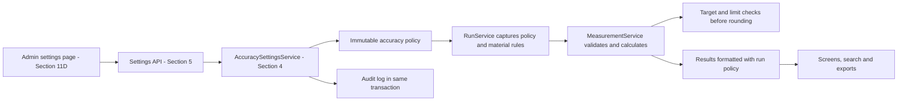

# Measurement & Accuracy Settings

Status: owner-added scope, 2026-09-08. Backend implementation belongs to
Section 4; production endpoints to Section 5; the new Admin page to Section
11D. This extends the supplied prototype. The Section 4 backend and migration
are implemented, reviewed and CI verified; the API and page remain scheduled
for their approved later sections. See [implementation](../run-lifecycle.md).

Amendment confirmed on 2026-09-11 (D30): separate current display rounding from
recording accuracy. Admin changes apply across all screens, including existing,
Reviewed and legacy runs. Stored readings, captured recording accuracy, original
statistics, alarms and historical audit payloads remain unchanged. For example,
displaying `102.004` as `102.00` cannot turn a recorded threshold breach into a pass.
The backend amendment is implemented; its verification evidence is recorded in
the [full review](../reviews/section-04-review.md).

## Confirmed behavior

- Use maximum individual-point target deviation for the alarm; show maximum
  variation about the four-point mean separately as uniformity.
- Factory-wide decimal-place settings; material-specific alarm limits.
- Initial scales: resistance 2, thickness 3, speed 2, measured length 2,
  calculated results 2. Scales may be set to integers from 0 through 6.
- Admin chooses half-up (initial default) or half-even rounding.
- Transfer physical quantities/results as decimal strings. Reject input beyond
  the configured scale. Compare alarm limits before rounding calculated results.
- Each new run captures the effective accuracy policy, including rounding;
  later changes preserve existing runs. Material detection rules retain their
  existing full run snapshot.
- Initial target-deviation tolerance is 2.00%, adjustable by Admin per material.
- Thickness values such as 0.006 mm must survive entry, storage and readback.
- Current display places (0–6 for each group) and half-up/half-even mode are
  independently Admin adjustable. A lower display precision is allowed even
  when material or measurement data has more digits. Raising display places
  pads available values; it does not recover precision absent from recorded data.

## Admin page

Provide a Measurement & Accuracy Settings entry in the Admin navigation.
Show separate Recording Accuracy and Screen Display controls. Show each
quantity's unit, places and an example value; show rounding with halfway examples.
Recording settings apply to new runs; display settings affect every current
screen on refresh. Reuse the material editor for target,
upper/lower resistance limits, thickness limits, deviation tolerance and check
switches. Uniformity is informational, not an additional enabled alarm.

On save, validate supported scales and existing material-rule compatibility,
then persist the new policy and audit actor, server time and before/after
settings atomically. Show which recording policy new runs will use. Existing
records and export data retain their captured policy. Display-only saves need
no material-precision compatibility check. Do not silently modify material
standards to fit a lower precision. Exact values remain available in details
and edit controls; never initialize a measurement edit from rounded display text.
Existing alarm badges use the recorded decision even when displayed values round
to the boundary. Rendering choices for exported files remain Section 7 work.

## Types and storage direction

| Value | Type / rule |
| --- | --- |
| Decimal places | Integer 0–6, independently selected per quantity group |
| Rounding mode | Controlled choice: half-up or half-even |
| Measurements and thresholds | Python Decimal / MySQL DECIMAL; no binary-float conversion |
| API quantities | Decimal strings formatted according to the run policy |
| Screen values | Separate display strings using the current global preference; canonical API quantities stay exact |
| IDs, versions, intervals, sample counts | Integer |
| Policy/audit event times | Authoritative server UTC; display Asia/Shanghai |

Migration `b6d84e19a203` widens numeric storage to `DECIMAL(24,6)` so six-place
settings can be used without changing tables from the Admin page. Physical
input retains eight integer digits; calculated results have extra capacity
for percentages against very small targets. MySQL DECIMAL scale
sets its stored fractional capacity; a form setting alone cannot increase it.
See [MySQL's exact numeric types](https://dev.mysql.com/doc/refman/8.4/en/fixed-point-types.html).

Store policy versions immutably and reference the effective version from a
run. A current-policy pointer selects defaults for new runs. Existing records
need an explicit legacy policy preserving their original scale and computation
meaning; do not relabel historical prototype values or recalculate old results
under the new formula. Narrowing a database on downgrade must reject data that
cannot be represented exactly, instead of silently discarding fractional digits.

An additional current operational switch lets Admin enable/disable Operator
work on their own Abnormal runs. Its initial value is enabled. Unlike captured
numeric policy, this permission switch is checked against current settings on
every write and takes effect immediately for existing runs.

Migration `c2a54f8d7109` adds a separate `display_settings` singleton with five
integer scales, rounding mode, positive revision, server UTC update time and
optional updating-Admin FK. Initial preferences copy the current factory
recording accuracy once; subsequent changes are independent. `DisplaySettingsService`
allows every permitted reader to fetch preferences, Admin-only audited changes,
revision conflicts and durable retries. Shared `DisplayFormatter` supplies
rounded copies for all future numeric screens. No Run references this singleton
as its recording policy.

## Class/data flow and delivery sections

Share the numeric policy and calculators across manual and future automated
entry. Settings updates and run creation must use a consistent transaction
lock order so a run never sees a partially changed policy.

## Acceptance additions

1. Admin-only settings writes; Operators/Reviewers cannot bypass authority.
2. Verify scales 0, 3 and 6, invalid scales and invalid rounding choices.
3. Preserve 0.006 mm and 0.008 mm exactly in real MySQL and API serialization.
4. Show that a policy change affects a new run while an existing run keeps
   its entry validation, calculations, formatting and historical audit meaning.
5. Reject precision decreases incompatible with current material standards;
   do not silently round those standards or measurements.
6. Verify half-up/half-even halfway results and alarms just inside/on/outside
   a boundary before display rounding.
7. Test settings-update versus run-start races, stale updates, retry deduplication
   and rollback if auditing or persistence fails.
8. Test populated upgrade, legacy interpretation, drift and lossless downgrade
   behavior against MySQL. Update the schema and operating documentation.
9. Change display precision/mode across Active, Abnormal, Pending Review,
   Reviewed and legacy runs. Prove stored production rows and historical audits
   remain equal, and that canonical edit values retain all recorded digits.
10. Verify display-only Admin authorization, audit rollback, stale/concurrent
    changes, retry behavior, null/zero handling and coherent preference reads.

Confirmed lifecycle choices are recorded in the main
[Section 4 plan](04-run-lifecycle.md) and [decision register](../decisions.md).
