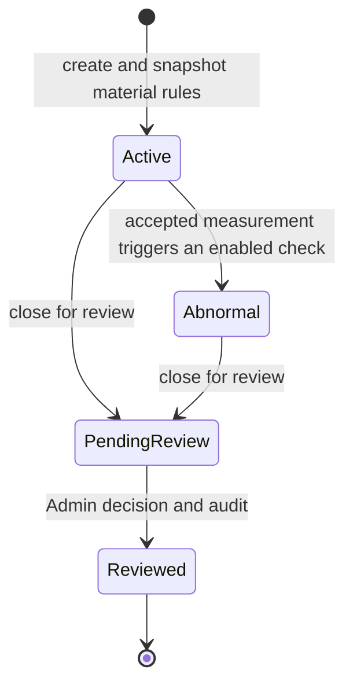

# Section 4: Core Domain Logic — Run Lifecycle (OOP service layer)

Status: authorized by the owner on 2026-09-08. Section 3 merged as `f7bee48`;
work proceeds on `codex/section-04-run-lifecycle`. Domain services and a new
migration are implemented; local checks, full-section review and MySQL CI passed
for `f344197`. Owner verification is pending. See the
[full review](../reviews/section-04-review.md) and [implementation](../run-lifecycle.md).

## Purpose and scope

Implement the services that start runs, record measurements, detect abnormality,
close runs for review, and record an Admin's final decision. Material-rule
administration, full snapshot copying, ownership checks, immutable history,
audit atomicity, repeated requests and simultaneous edits belong here.

The existing FastAPI/SQLAlchemy/MySQL 8.4 stack and Decimal storage policy remain.
Production HTTP endpoints belong to Section 5; operational screens to Sections
10–13; export and automated ingestion to Sections 7–8. Those callers must reuse
these production services rather than write directly to ORM models.

## Confirmed implementation decisions

The owner answered the implementation questions in D19–D29 of
[the decision register](../decisions.md).

| Decision | Current evidence / question |
| --- | --- |
| Factory timezone and units (D19/D23) | `Asia/Shanghai`, resistance Ω, thickness mm, speed m/min, meter count m. UTC storage; initial thickness scale 3 and other quantities/results scale 2. |
| Self-review (D20) | Confirmed: Admin self-review is allowed, requires a reason, and must be explicitly recorded with the reason in the audit log. This grants no operational review authority to the Reviewer role. |
| Deviation tolerance and formula (D21/D22) | Initial target-deviation tolerance 2.00%, Admin configurable per material. Uniformity shown separately. Exact boundaries pass. |
| Decimal contract and rounding (D24/D25) | Factory-wide scales 0–6; Admin-selectable half-up (initial) or half-even. Decimal strings, reject excess input places, evaluate alarms before result rounding. Capture each run's policy. |
| Completeness and closure (D26) | Require four points and length, thickness when checked; speed optional. Partial rows persist. Missing-data closure requires an Admin reason and audit, with gaps retained in review/export. |
| Operational settings and scheduling (D27–D29) | Operators may work on their own Abnormal runs initially; Admin can disable that authority immediately. Track scheduled slots from run start and allow extra manual samples. Zero is a real reading; input time stays between start and server now. |

The terminal Reviewed state remains unchanged; reopening is not part of the
accepted lifecycle. New settings controls are covered by the
[accuracy settings contract](04-accuracy-settings.md).

## Selected deviation calculation and examples

For four complete resistance readings `x1` through `x4`, let `A` be their
arithmetic mean and `T` the snapshotted material target. These examples assume
positive `A` and `T`. A zero target is invalid; when all four readings are zero,
target deviation is 100% and uniformity percentage is null because its denominator is zero.

| Statistic | Definition | What it detects |
| --- | --- | --- |
| Uniformity variation (prototype calculation) | `100 × max(abs(xi - A)) / A` | How far the worst point is from the sample's own average. All readings can miss the target together while this value stays zero. |
| Maximum target deviation (selected primary alarm) | `100 × max(abs(xi - T)) / T` | Whether any individual point is too far from the required material target. High and low readings cannot cancel one another. |

Examples with target `100.00 Ω` and inclusive `2.00%` tolerance:

| Four readings (Ω) | Average (Ω) | Uniformity variation | Maximum target deviation | Target check |
| --- | --- | --- | --- | --- |
| 100.00, 100.00, 100.00, 100.00 | 100.00 | 0.00% | 0.00% | Pass |
| 110.00, 110.00, 110.00, 110.00 | 110.00 | 0.00% | 10.00% | Alarm |
| 97.00, 99.00, 101.00, 103.00 | 100.00 | 3.00% | 3.00% | Alarm despite an average exactly at target |
| 98.00, 100.00, 100.00, 102.00 | 100.00 | 2.00% | 2.00% | Pass at the inclusive boundaries |

The owner selected maximum target deviation for the tolerance alarm and
uniformity as a separate statistic to help investigate uneven production.
A target of `100.00 Ω` permits each reading
from `98.00 Ω` through `102.00 Ω` for this check. Independently enabled absolute
resistance limits and thickness checks still apply; passing one check is not
an overall normal result. Do not compare only the average with the target.

The distinction between process variability and conformity to specification
is described in the [NIST engineering statistics handbook](https://www.itl.nist.gov/div898/handbook/pmc/section1/pmc16.htm).
The two formulas above are application definitions, not NIST capability
indices. The 2.00% tolerance is the owner's provisional product requirement.

Use the existing material-rule configuration for Admin adjustment, with
audited changes and full copying into new runs. An adjustment must not change
the rules on active or historical runs. No prototype sample data is being
imported or rescaled as part of this decision record.

## Established lifecycle and authority

`pending_from` records whether the run entered review from Active or Abnormal.
The approved schema defines Approved for the former, and Confirmed Abnormal or
False Alarm for the latter. No direct Active → Reviewed, no close-without-review,
and no reopening transition is authorized. Do not silently clear an Abnormal
run back to Active after later measurements improve.

Admin has operational authority. Operator can read all runs, create runs and
edit/close their own Active and Abnormal runs, subject to the current Admin
Abnormal-work switch. Missing-data closure remains Admin-only. Reviewer
reads/exports only. Production writes recheck current server-side authority
inside their transaction; a stale Identity or browser role claim is insufficient.

## Class responsibilities

| Component | Responsibility |
| --- | --- |
| Numeric policy / measurement calculator | Validate physical quantities as Decimal, calculate approved statistics, round only at the approved stage and serialize consistent decimal strings. |
| AccuracySettingsService | Publish immutable precision/rounding versions and current operational settings with Admin authorization and audit. |
| Production time policy | Normalize factory-entered times to UTC, reject/resolve invalid or ambiguous local times according to policy, and use the injectable server clock for authoritative events. |
| AbnormalityDetector | Evaluate every enabled rule against the run snapshot and return explicit reason codes/details; use no mutable material lookup. |
| MaterialService | Admin-only create/update/deactivate/reactivate with validation, current authority checks, revision protection and before/after audit. |
| RunService | Start a run with a complete immutable rule snapshot, guard lifecycle invariants and close eligible runs for review. |
| MeasurementService | Create/update/complete eligible measurements, calculate results, evaluate rules and update run abnormality state within one audited transaction. |
| ReviewService | Check review eligibility, self-review policy and resolution/reason, set reviewer/time and terminal Reviewed state atomically. |
| Shared production transaction support | Reuse auth/session checks, enforce a consistent lock order, reject stale revisions and coordinate safe retry behavior with audit persistence. |

Use immutable result/value objects where practical; callers receive validated
service results rather than mutable ORM instances that could bypass invariants.
Keep shared transaction, validation, snapshot and audit code in one place.

## Acceptance checklist

| ID | Required behavior | Verification |
| --- | --- | --- |
| DOMAIN-01 | Physical input and calculated results obey the approved decimal policy; invalid/nonfinite/overflow values are rejected before persistence. | Hand-calculated examples, precision/range/rounding boundaries and invalid input tests. |
| DOMAIN-02 | Statistics and enabled alarm rules use the approved formula and inclusive/exclusive boundaries; missing data never becomes an invented zero or normal result. | Pure calculator/detector tests covering each enabled/disabled rule, exact threshold and simultaneous rule failures. |
| DOMAIN-03 | Starting a run selects an active material, copies all nine rule fields exactly once, records creator/time and returns a unique run identity. | Full snapshot equality; invalid/inactive material rejection; material edit/start race on MySQL. |
| DOMAIN-04 | Material changes are Admin-only, validate coherent ranges and record before/after audit; support the confirmed initial 2.00% deviation tolerance and Admin adjustment. Existing runs keep their original rules. | Authorized/denied mutations, tolerance configuration, stale revision rejection, snapshot independence and rollback. |
| DOMAIN-05 | Measurement writes enforce run ownership/state, approved completeness and time/range rules; calculated fields cannot be injected by callers. | Role/state matrix, partial/complete cases, forged calculated fields and failed-write assertions. |
| DOMAIN-06 | A qualifying measurement marks its run Abnormal in the same transaction; later work cannot silently erase the need for review. | Normal/abnormal transitions, snapshot-based evaluation after material edits and repeat updates. |
| DOMAIN-07 | Closure records end time, pending_from and PendingReview only for eligible runs and roles, following the approved missing-data policy. | Every permitted/rejected source state, time ordering, repeated close and missing-data cases. |
| DOMAIN-08 | Review is Admin-only; self-review is allowed with a required reason and explicit audit record. Apply approved resolution policy; reviewed rows have consistent final fields. | Full resolution/source-state matrix, self-review success/reason rejection/audit contents, direct permission bypass, blank/invalid reasons, repeat review and terminal immutability. |
| DOMAIN-09 | Every mutation and audit commit together; actor, event, target, timestamps and relevant before/after values are present. | Inject audit/persistence failures after prior writes and assert no partial state or misleading success audit survives. |
| DOMAIN-10 | Concurrent edits, edit-versus-close, close-versus-review and material-edit-versus-start cannot lose updates or apply mixed snapshots. | Deterministic independent-connection MySQL races, explicit conflict outcomes and final-row invariants. |
| DOMAIN-11 | Retrying a successfully submitted operation cannot create duplicate runs/measurements or duplicate transition audits. Conflicting retries are rejected. | Repeated request tests and concurrent duplicate submissions under the chosen persisted retry contract. |
| DOMAIN-12 | Current account disable/demotion/session expiry is respected by production writers, including races with administration. | Transaction-level permission tests and MySQL concurrency assertions. |
| DOMAIN-13 | All authoritative times use UTC; normalize accepted Asia/Shanghai factory inputs consistently, including clock/date boundaries. Use confirmed Ω, mm, m/min and m units with captured precision. | Injected-clock and Shanghai/UTC date-boundary tests; unit and approved precision examples. |
| DOMAIN-14 | Any schema additions extend the approved migrations without rewriting their operations; existing data/roles/auth survive upgrade. | Populated MySQL upgrade/check/seed/downgrade, schema constraints and drift tests. |
| DOMAIN-15 | Important service functions are documented and tested; workflow/data flow, variables, class relationships and operating examples are current. | Function/doc review, executable synthetic lifecycle demonstration and full section diff review. |

## Implementation sequence

1. Resolve the open product decisions and write worked measurement examples.
2. Implement shared decimal/time value policies and pure statistics/rule logic;
   test success, rejection and exact boundaries before composing write services.
3. Design the transaction/revision/retry contract and any necessary new migration.
   Test populated upgrade and model parity on MySQL.
4. Implement MaterialService and RunService creation with complete snapshots,
   current authority and audit atomicity.
5. Implement MeasurementService, abnormality transitions, closure and ReviewService
   after their earlier service tests pass. Include every lifecycle rejection.
6. Exercise cross-service MySQL races, rollback and retry behavior; run existing
   backend and frontend regression checks through the section PR.
7. Complete documentation and the synthetic end-to-end service demonstration,
   review the entire section against `f7bee48`, fix findings and rerun affected
   checks before asking the owner to verify Section 4.

## Exit and evidence

Record test commands/counts, exact PR head and CI run, full-review findings and
untested limits. Passing a partial test suite or completing this plan does not
complete Section 4. Section 5 remains gated on owner verification of this section.
