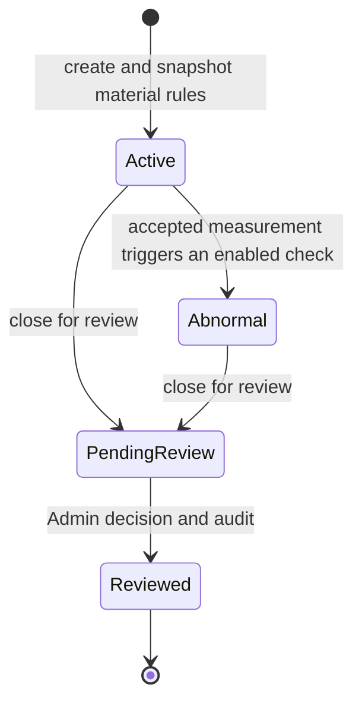

# Section 4: Core Domain Logic — Run Lifecycle (OOP service layer)

Status: authorized by the owner on 2026-09-08. Section 3 merged as `f7bee48`;
work proceeds on `codex/section-04-run-lifecycle`. This is the acceptance and
implementation plan, not a claim that production services have been built.

## Purpose and scope

Implement the services that start runs, record measurements, detect abnormality,
close runs for review, and record an Admin's final decision. Material-rule
administration, full snapshot copying, ownership checks, immutable history,
audit atomicity, repeated requests and simultaneous edits belong here.

The existing FastAPI/SQLAlchemy/MySQL 8.4 stack and Decimal storage policy remain.
Production HTTP endpoints belong to Section 5; operational screens to Sections
10–13; export and automated ingestion to Sections 7–8. Those callers must reuse
these production services rather than write directly to ORM models.

## Decisions before dependent implementation

The following questions were sent to the owner. Answers must be recorded in
[the decision register](../decisions.md) before implementing dependent behavior.
Unanswered choices remain open; a proposed default is not an approved policy.

| Decision | Current evidence / question |
| --- | --- |
| Factory timezone and units (Q05) | The prototype labels resistance in Ω and thickness in μm, but does not establish the factory timezone or speed unit. Confirm timezone and resistance/thickness/speed/meter-count units. Do not infer the factory timezone from the developer workstation. |
| Self-review (Q06) | May an Admin review their own run, or must another Admin do it? Any permitted self-review must remain explicit in the audit. |
| Deviation formula (Q04) | Prototype `computeStats` uses maximum absolute distance from the four-point average, divided by that average; its alarm label mentions the material standard. Four readings of 110.00 against a 100.00 standard produce 0.00% by the first definition and 10.00% by the second. Owner choice required. |
| Decimal contract and rounding (Q04) | Proposed: API decimal strings, reject input with more than two fractional places, ROUND_HALF_UP for stored/displayed results, evaluate alarms before result rounding. Confirm before calculators/validation are written. |
| Completeness and closure (Q05/Q06) | Which of four points, thickness, speed and meter count are required for completion? May a run close for review with missing/incomplete measurements? |

Clarify remaining behavior exposed by those answers before coding it, including
valid zero/range semantics, correction authority for abnormal runs, review
reasons, measurement scheduling and backdated times. Keep the agreed terminal
Reviewed state; reopening is not part of the accepted lifecycle.

## Established lifecycle and authority

`pending_from` records whether the run entered review from Active or Abnormal.
The approved schema defines Approved for the former, and Confirmed Abnormal or
False Alarm for the latter. No direct Active → Reviewed, no close-without-review,
and no reopening transition is authorized. Do not silently clear an Abnormal
run back to Active after later measurements improve.

Admin has operational authority. Operator can read all runs, create runs and
edit their own active runs. Reviewer reads/exports only. The exact rights for
correcting an abnormal run and requesting its closure must be resolved with
the owner, since the prototype offers edits in that state while D16 explicitly
names active runs. Production writes must recheck current server-side authority
inside their transaction; a stale Identity or browser role claim is insufficient.

## Proposed class responsibilities

| Component | Responsibility |
| --- | --- |
| Numeric policy / measurement calculator | Validate physical quantities as Decimal, calculate approved statistics, round only at the approved stage and serialize consistent decimal strings. |
| Production time policy | Normalize factory-entered times to UTC, reject/resolve invalid or ambiguous local times according to policy, and use the injectable server clock for authoritative events. |
| AbnormalityDetector | Evaluate every enabled rule against the run snapshot and return explicit reason codes/details; use no mutable material lookup. |
| MaterialService | Admin-only create/update/deactivate/reactivate with validation, current authority checks, revision protection and before/after audit. |
| RunService | Start a run with a complete immutable rule snapshot, guard lifecycle invariants and close eligible runs for review. |
| MeasurementService | Create/update/complete eligible measurements, calculate results, evaluate rules and update run abnormality state within one audited transaction. |
| ReviewService | Check review eligibility, self-review policy and resolution/reason, set reviewer/time and terminal Reviewed state atomically. |
| Shared production transaction support | Reuse auth/session checks, enforce a consistent lock order, reject stale revisions and coordinate safe retry behavior with audit persistence. |

Use immutable result/value objects where practical; callers receive validated
service results rather than mutable ORM instances that could bypass invariants.
Keep shared transaction, validation, snapshot and audit code in one place.

## Acceptance checklist

| ID | Required behavior | Verification |
| --- | --- | --- |
| DOMAIN-01 | Physical input and calculated results obey the approved decimal policy; invalid/nonfinite/overflow values are rejected before persistence. | Hand-calculated examples, precision/range/rounding boundaries and invalid input tests. |
| DOMAIN-02 | Statistics and enabled alarm rules use the approved formula and inclusive/exclusive boundaries; missing data never becomes an invented zero or normal result. | Pure calculator/detector tests covering each enabled/disabled rule, exact threshold and simultaneous rule failures. |
| DOMAIN-03 | Starting a run selects an active material, copies all nine rule fields exactly once, records creator/time and returns a unique run identity. | Full snapshot equality; invalid/inactive material rejection; material edit/start race on MySQL. |
| DOMAIN-04 | Material changes are Admin-only, validate coherent ranges and record before/after audit; existing runs keep their original rules. | Authorized/denied mutations, stale revision rejection, snapshot independence and rollback. |
| DOMAIN-05 | Measurement writes enforce run ownership/state, approved completeness and time/range rules; calculated fields cannot be injected by callers. | Role/state matrix, partial/complete cases, forged calculated fields and failed-write assertions. |
| DOMAIN-06 | A qualifying measurement marks its run Abnormal in the same transaction; later work cannot silently erase the need for review. | Normal/abnormal transitions, snapshot-based evaluation after material edits and repeat updates. |
| DOMAIN-07 | Closure records end time, pending_from and PendingReview only for eligible runs and roles, following the approved missing-data policy. | Every permitted/rejected source state, time ordering, repeated close and missing-data cases. |
| DOMAIN-08 | Review is Admin-only and applies the approved self-review/reason/resolution policy; reviewed rows have consistent final fields. | Full resolution/source-state matrix, direct permission bypass, blank/invalid reasons, repeat review and terminal immutability. |
| DOMAIN-09 | Every mutation and audit commit together; actor, event, target, timestamps and relevant before/after values are present. | Inject audit/persistence failures after prior writes and assert no partial state or misleading success audit survives. |
| DOMAIN-10 | Concurrent edits, edit-versus-close, close-versus-review and material-edit-versus-start cannot lose updates or apply mixed snapshots. | Deterministic independent-connection MySQL races, explicit conflict outcomes and final-row invariants. |
| DOMAIN-11 | Retrying a successfully submitted operation cannot create duplicate runs/measurements or duplicate transition audits. Conflicting retries are rejected. | Repeated request tests and concurrent duplicate submissions under the chosen persisted retry contract. |
| DOMAIN-12 | Current account disable/demotion/session expiry is respected by production writers, including races with administration. | Transaction-level permission tests and MySQL concurrency assertions. |
| DOMAIN-13 | All authoritative times use UTC and normalize accepted factory inputs consistently, including clock/date boundaries. | Injected-clock and timezone tests; explicit DST ambiguity/nonexistent-time cases where applicable. |
| DOMAIN-14 | Any schema additions extend the approved migrations without rewriting their operations; existing data/roles/auth survive upgrade. | Populated MySQL upgrade/check/seed/downgrade, schema constraints and drift tests. |
| DOMAIN-15 | Important service functions are documented and tested; workflow/data flow, variables, class relationships and operating examples are current. | Function/doc review, executable synthetic lifecycle demonstration and full section diff review. |

## Implementation sequence

1. Resolve the open product decisions and write worked measurement examples.
2. Implement shared decimal/time value policies and pure statistics/rule logic;
   test success, rejection and exact boundaries before composing write services.
3. Design the transaction/revision/retry contract and any necessary new migration.
   Test populated upgrade and model parity on MySQL.
4. Implement MaterialService and RunService creation with complete snapshots,
   current authority and audit atomicity.
5. Implement MeasurementService, abnormality transitions, closure and ReviewService
   after their earlier service tests pass. Include every lifecycle rejection.
6. Exercise cross-service MySQL races, rollback and retry behavior; run existing
   backend and frontend regression checks through the section PR.
7. Complete documentation and the synthetic end-to-end service demonstration,
   review the entire section against `f7bee48`, fix findings and rerun affected
   checks before asking the owner to verify Section 4.

## Exit and evidence

Record test commands/counts, exact PR head and CI run, full-review findings and
untested limits. Passing a partial test suite or completing this plan does not
complete Section 4. Section 5 remains gated on owner verification of this section.
